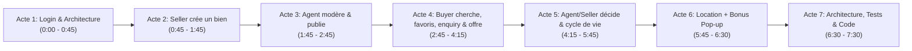

# Scénario Béton — Test Complet & Soutenance HOLMIA

> [!TIP]
> **Objectif :** Démontrer en **6 à 8 minutes** un parcours réaliste de bout en bout à 3 voix (**ABD = Seller**, **Timothé = Agent**, **Ariel = Buyer**) qui coche **100 % des 25 points de la grille officielle** (plafonnée à **20/20**) tout en éliminant tout risque de crash (*-2 pts*).

---

## 1. Préparation 15 minutes avant la présentation (Check-list anti-crash)

1. **Vérifier Supabase :**
   - S'assurer que toutes les migrations sont appliquées (y compris `20261124120000_rental_decisions.sql`, `20261124130000_property_transitions.sql`, `20261124140000_recette_fixes.sql`).
   - Vérifier que les 6 biens de démo de base sont en statut `active` et qu'il n'y a pas d'anciennes annonces de test qui polluent l'écran.
2. **Configuration 2 écrans / 2 fenêtres (effet "Wahou" garanti) :**
   - Ouvrir **2 fenêtres côte à côte** sur `http://localhost:8081` (ou 1 téléphone + 1 navigateur) :
     - **Fenêtre A :** Compte actif pendant la démo (Seller → Buyer).
     - **Fenêtre B :** Compte **Agent** (`agent@holmia.example`) déjà ouvert — permet de voir les **notifications pop-up en temps réel** tomber en direct quand le Buyer envoie une offre ou une demande !
3. **Terminal prêt en arrière-plan :**
   - Un terminal PowerShell dans le dossier `HOLMIA` prêt à lancer `npm run test:all` (pour prouver en 5 secondes les **12 suites / 300+ tests** + `npm run lint` = 0 erreur si le jury pose des questions techniques).
4. **Plan B hors-ligne :**
   - Avoir le bouton **`Test pop-up notification`** dans l'onglet `Profile` prêt si le Wi-Fi de la salle coupe Realtime.

---

## 2. Le Scénario de Démonstration (7 actes — ~7 min)

---

### Acte 1 — Accueil, Connexion & Répartition (0:00 – 0:45)
- **Intervenant :** Timothé (intro d'équipe)
- **Actions à l'écran :**
  1. Montrer l'écran d'accueil **City Estate** (`LoginScreen`).
  2. Montrer qu'on peut se connecter par **Username ou Email + Password** (et montrer brièvement le lien *Create account*).
  3. Se connecter avec **`seller@holmia.example`** (ABD prend la main).
- **Points de grille cochés :**
  - ✅ *Home window EMAIL / LAST NAME + PASSWD* (**2/2 pts**)
  - ✅ *Cohésion d'équipe & scénario préparé* (**2/2 pts**)

---

### Acte 2 — Le Vendeur crée et gère une annonce (0:45 – 1:45)
- **Intervenant :** ABD (**Seller** — `seller@holmia.example`)
- **Actions à l'écran :**
  1. Aller dans **`My listings`** : montrer que le vendeur ne voit **que ses propres biens**.
  2. Cliquer sur **`Add`** (`SellerPropertyFormScreen`) :
     - Remplir un bien propre et réaliste :
       - **Title :** `Chelsea Garden Flat`
       - **Description :** `Bright two-bedroom flat with private patio, 5 min from Sloane Square.`
       - **Price :** `480000`
       - **Type :** `Sale` · **Property type :** `Flat` · **Location :** `London, UK`
       - **Image :** sélectionner une photo dans le sélecteur d'images.
       - **Representation :** assigner **Demo Agent**.
     - Cliquer **Save** ➔ le bien est créé en statut **`Draft`** (non visible au public).
  3. *(Optionnel rapide)* Montrer la validation en essayant un prix vide ou négatif → message d'erreur clair.
- **Points de grille cochés :**
  - ✅ *Effective use of media* (**2/2 pts**)
  - ✅ *Good interaction through various tools & multiple choices* (**2/2 pts**)

---

### Acte 3 — L'Agent modère, publie et consulte ses KPIs (1:45 – 2:45)
- **Intervenant :** Timothé (**Agent** — `agent@holmia.example`)
- **Actions à l'écran :**
  1. **Écran d'accueil Agent (`Stats` — Dashboard) :**
     - Montrer les 3 indicateurs exigés calculés en direct par la base (`agent_dashboard()`) :
       - **Active listings** & **Average price** (cartes terracotta Figma)
       - **Active listings per user**
       - **Offers per property**
  2. Aller dans **`Review`** (`Listings to review`) :
     - Le brouillon **`Chelsea Garden Flat`** créé par ABD apparaît avec son badge `Draft` et son aperçu image !
     - Cliquer **`Approve`** ➔ le bien passe instantanément de `Draft` à **`Active`**.
  3. Aller dans **`Properties`** (`Managed properties`) :
     - Montrer la recherche (`Search...`) et les 4 pills (`All`, `Active`, `Under offer`, `Sold`).
     - Cliquer sur **`Chelsea Garden Flat`** ➔ montrer son **`Status history`** (`Draft → Active`, horodaté avec l'auteur).
- **Points de grille cochés :**
  - ✅ *Visual quality, ergonomics, Figma fidelity* (**2/2 pts**)
  - ✅ *Reliability & relevance of displayed info* (**2/2 pts**)
  - ✅ *Role accessibility including history* (**2/2 pts**)

---

### Acte 4 — L'Acheteur filtre, met en favori, pose une question et fait une offre (2:45 – 4:15)
- **Intervenant :** Ariel (**Buyer** — `buyer@holmia.example`)
- **Actions à l'écran :**
  1. **`Browse` :** utiliser **`Filters`** (filtrer par `Sale`, `Flat`, `London`, fourchette de prix) ➔ **`Chelsea Garden Flat`** apparaît immédiatement !
  2. Cliquer sur le **cœur** (Favoris) ➔ aller sur l'onglet **`Favourites`** pour prouver la persistance.
  3. Ouvrir la fiche **`Chelsea Garden Flat`** (`PropertyDetailsScreen`) :
     - Cliquer **`Book a viewing`** (Écran 18 Figma bonus) : choisir une **date dans le calendrier interactif** + un **créneau horaire** (`10:00`, `14:00` ou `17:00`) → cliquer **`Request viewing`** !
       - 👉 *La demande de visite est enregistrée (visible dans `My activity → Viewings`), une **notification pop-up `VIEWING`** s'affiche, et une demande structurée `[Viewing Request]` est envoyée en direct au Seller/Agent !*
     - Cliquer **`Send enquiry`** : envoyer *"Hello, is the patio south-facing?"*.
       - 👉 *Sur la Fenêtre B (Agent), la **notification pop-up flottante** glisse en haut de l'écran !*
     - Cliquer **`Make offer`** : soumettre une offre de **`£475,000`** avec un message court.
       - 👉 *Nouvelle **notification pop-up** en temps réel côté Agent !*
  4. Aller dans l'onglet **`Offers` (`My activity`)** : montrer les 3 sous-onglets **`Offers`** (`£475,000` en `Pending`), **`Applications`**, et **`Viewings`** (la visite réservée en `Pending`).
- **Points de grille cochés :**
  - ✅ *Filters (price, location, property type, sale/rent)*
  - ✅ *Favourites, Enquiries, Offers*
  - ✅ *Extensions (+5 pts) : **Scheduling of viewings** + pop-up temps réel en direct !*

---

### Acte 5 — Décision atomique, verrouillage & cycle de vie irréversible (4:15 – 5:45)
- **Intervenant :** Timothé (**Agent**) + ABD (**Seller**)
- **Actions à l'écran :**
  1. Sur la fenêtre **Agent**, cliquer directement sur la **notification pop-up** (ou aller dans **`Received`**) :
     - Sous-onglet **`Viewings`** : montrer la demande de visite d'Ariel (date + créneau `14:00`) et cliquer **`Confirm`** (statut `Confirmed` + pop-up de confirmation).
     - Sous-onglet **`Enquiries`** : répondre à la question d'Ariel (*"Yes, south-facing! Looking forward to seeing you at the viewing."*).
     - Sous-onglet **`Offers`** : accepter l'offre de **£475,000** (et expliquer à l'oral que si d'autres offres concurrentes existaient, elles sont **rejetées atomiquement** dans la même transaction SQL).
  2. Aller sur **`Properties` → `Chelsea Garden Flat`** (`Manage property`) :
     - Constater que le statut est passé automatiquement à **`Under Offer`**.
     - Cliquer **`Edit details`** : montrer que **Price**, **Listing type** et **Property type** sont **verrouillés** (*locked when Under Offer*), alors que la description reste modifiable !
     - Revenir sur `Manage property` : sélectionner **`Sold`** dans `Change status to`, saisir une note (*"Completion signed"*), confirmer **`Update status`**.
     - Montrer que **`Sold` est un état terminal irréversible** (impossible de repasser `Sold → Active`, bouton bloqué + règle DB).
     - Montrer le **`Status history`** complet : `Created → Draft → Active → Under Offer → Sold` avec dates, auteurs et notes !
  3. Retour éclair sur la fenêtre **Buyer (`Offers` & `Profile → My enquiries`)** :
     - L'acheteur voit son offre passée à **`Accepted`** et la réponse de l'agent à son enquiry.
- **Points de grille cochés :**
  - ✅ *Listing Lifecycle (IMPORTANT)* : `Draft → Active → Under Offer → Sold`, verrouillages, terminal state, audit trail (**100 % validé**)
  - ✅ *Accurate presentation of the process to follow* (**2/2 pts**)

---

### Acte 6 — Locations (Rental Applications) & Contrôle des droits (5:45 – 6:30)
- **Intervenant :** Ariel (**Buyer**) + ABD (**Seller / Agent**)
- **Actions à l'écran :**
  1. Sur **Buyer**, filtrer sur **`Rent`**, ouvrir un bien en location (ex. *Oxford Student Studio*), cliquer **`Apply to rent`** :
     - Choisir une **date d'emménagement** dans le calendrier (`MoveInDate`) + ajouter une note (*"Postgraduate student, references ready"*).
  2. Sur **Agent / Seller (`Received → Applications`)** :
     - Montrer la candidature reçue avec la date d'emménagement et la note, puis **`Accept`** ➔ passage cohérent du cycle locatif (`Active → Under Offer → Rented`).
- **Points de grille cochés :**
  - ✅ *Rental Applications (FOR RENT)* avec *move-in date* et *notes* (**100 % validé**)

---

### Acte 7 — Preuve technique : Base locale, Qualité du code & Références (6:30 – 7:30)
- **Intervenant :** Timothé (conclusion technique)
- **Actions à l'écran :**
  1. Basculer 20 secondes sur VS Code / Terminal :
     - Montrer `README.md` (en anglais, avec le tableau des permissions RLS et la section **References Used During Development**).
     - Montrer 10 secondes `src/repositories/propertyRepository.ts` (code propre et commenté) + `RECETTE.md` + `TEST_REPORT.md`.
     - Lancer **`npm run test:all`** dans le terminal ➔ défilement vert des **12 suites (300+ tests)** : CRUD SQLite, persistance après fermeture/réouverture, isolation des rôles, offres atomiques, E2E !
  2. Conclure en 1 phrase sur le respect de la grille : **0 template externe**, **0 erreur ESLint**, **20/20 Expo Doctor**, **double persistance SQLite locale + Supabase cloud temps réel**.
- **Points de grille cochés :**
  - ✅ *Commented code including list of references* (**2/2 pts**)
  - ✅ *Extensions (+5 pts)* : API Supabase, Realtime pop-ups, images BDD, suite E2E + persistance disque
  - ✅ *Zéro pénalité* : 0 crash, 0 template/plugin UI tiers

---

## 3. Matrice de Vérification (Scénario vs Grille Officielle sur 25 pts)

| Critère officiel | Points | Prouvé à quel moment du scénario ? |
| :--- | :---: | :--- |
| Oral & scénario préparé en avance | 2 | Tout le déroulé chronométré en 7 actes à 3 voix |
| Home window Login (Email/Username + Password) | 2 | Acte 1 (`LoginScreen`) |
| Fiabilité & pertinence des infos affichées | 2 | Acte 3 (`agent_dashboard()` réel) + Acte 7 (`test:all`) |
| Qualité visuelle, fluidité, design multi-pages | 2 | Actes 1–6 (charte Figma `#F6F5F0` / `#292424` / `#B6331E`) |
| Interactions via outils variés | 2 | Recherche, 4 pills, filtres avancés, calendrier, dropdown, tchat |
| Processus clair & choix multiples | 2 | Cycle `Draft → Active → Under Offer → Sold/Rented`, confirm dialogs |
| Accessibilité par rôle **+ Historique** | 2 | 3 interfaces étanches + `Status history` complet (Acte 5) |
| Utilisation efficace des médias | 2 | Photos des biens + sélecteur d'images + illustrations fallback |
| Créativité (hors cahier des charges) | 2 | Notifications pop-up temps réel + modération brouillons + double BDD |
| Code commenté + liste des références | 2 | Acte 7 (`README.md` References + repositories commentés) |
| **Extensions bonus** | **+5** | **Scheduling of viewings (Figma 18)**, API Supabase, Realtime pop-ups, images BDD, 300+ tests E2E, SQLite locale |
| **Pénalités évitées** | **0** | 0 template UI tiers, 0 crash, `npm run lint` = 0 erreur |

---

## 4. Check-list de Répétition Générale (à tester ensemble avant le 2 déc.)

- [ ] **Test 1 (Reset propre) :** Exécuter les migrations manquantes dans Supabase (dont D-11 avec Ariel et `20261124140000_recette_fixes.sql`).
- [ ] **Test 2 (Chrono) :** Faire un filage complet à 3 en chronométrant (**cible : 6 min 30 – 7 min 30** pour laisser de la marge aux questions du jury).
- [ ] **Test 3 (Mobile / Web) :** Tester sur le support exact que vous utiliserez le jour J (navigateur Web ou téléphone + partage d'écran) pour vérifier qu'il n'y a aucune latence ni coupure.
- [ ] **Test 4 (Archive ZIP) :** Avant le **2 décembre à 16h**, tester de dézipper votre remise dans un dossier vierge et vérifier `src/`, `components/`, `assets/`, `README.md` et `npm run test:all`.
